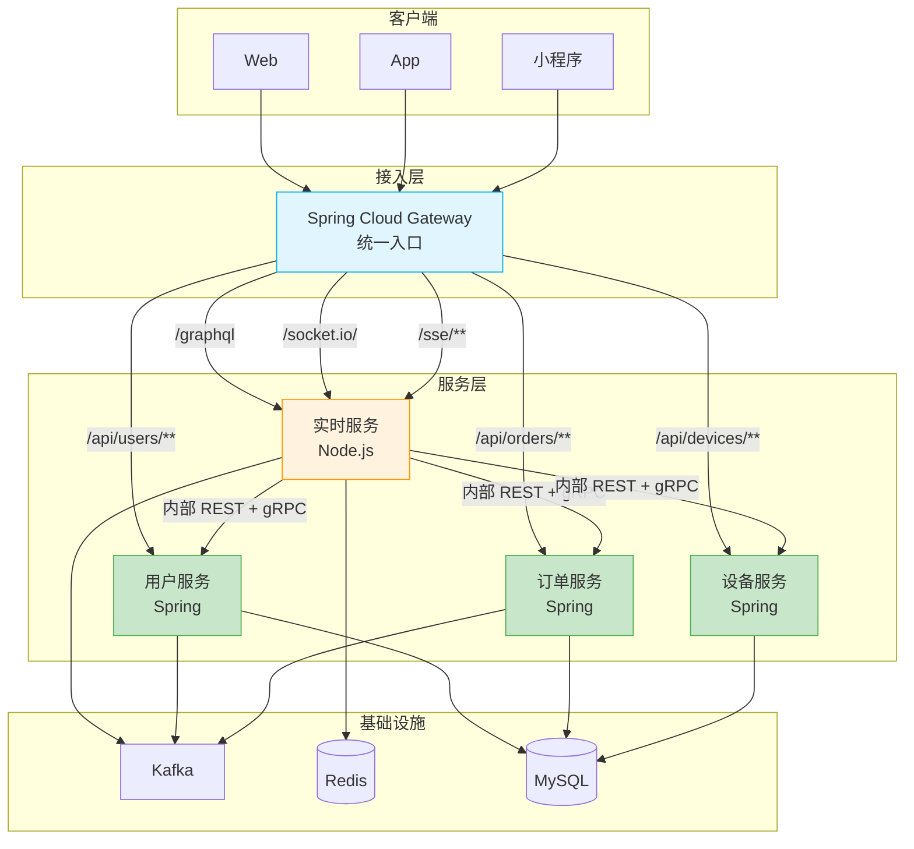

# 微服务集成

Node.js 服务不是独立后端，而是 Spring 微服务体系中的一个**能力节点**。本章说明如何在不改变现有 Spring 体系的前提下，将 Node.js 服务接入统一网关、统一认证、统一观测。

## 角色定位

- **接入层**：Spring Cloud Gateway 作为唯一入口，按路径静态路由到 Spring 服务或 Node.js 服务；设备侧经网关 WebSocket 路由或内网直连接入
- **服务层**：Node.js 服务与 Spring 服务平级，每个 Spring 服务同时暴露内部 REST（简单透传、首屏全量查询）与 gRPC（聚合场景批量取数），Node.js 不直连数据库
- **基础设施**：Kafka 用于事件驱动，Redis 用于缓存与广播，MySQL 仅由 Spring 服务持有

## 框架基线

框架核心包为 ESM-only，CommonJS 应用经 `require(esm)` 继续运行，无需重写；项目自身是否迁移 ESM 是独立决策。

| 项 | 基线 | 集成影响 |
|----|------|---------|
| Node.js（运行） | ≥ 20.19 或 ≥ 22.12，21.x 不支持 | `require(esm)` 在该版本起无旗标启用，是 CJS 应用消费 ESM 包的底线 |
| Node.js（CLI） | ≥ 22.22.3 / 24.15 / 26 | `nest new` / `nest generate` / `nest upgrade` 由 `@nestjs/schematics` 决定，门槛高于运行时 |
| 升级方式 | `npm i -g @nestjs/cli@latest && nest upgrade` | 一次性对齐全部 `@nestjs/*` 包到同一 major 并自动完成机械迁移，先以 `--dry-run` 出报告 |
| 生命周期钩子 | 按组件层级顺序调用 | 跨模块的初始化顺序不再隐式保证，需显式落到阶段约定上（见 [服务间通信 · Kafka](./communication/README.md#kafka-事件驱动)） |
| GraphQL | GraphiQL 为默认 IDE；订阅传输为 `graphql-ws`（`subscriptions-transport-ws` 不再支持） | 本方案推送走 SSE，GraphQL 不承载订阅，不受传输协议切换影响 |
| `@nestjs/config` | `validationSchema` 接受 Standard Schema（Zod / Valibot / ArkType / Joi ≥ 18） | 配置校验不绑定特定库；Joi 场景库级选项移入 `validationOptions.libraryOptions` |
| `@nestjs/terminus` | 健康指标基于 `HealthIndicatorService` | 自定义指标以 `up()` / `down()` / `attempt()` 显式报告状态（见 [可观测性](./observability/README.md#健康检查)） |
| 内置横切能力 | CSRF 防护、安全响应头、cookies、全局前缀数组、文件上传拦截器 | 框架原生提供，减少第三方依赖（见 [安全基线](../features/security/README.md)） |

## 通道职责

四类出口各司其职，能力不重叠：

| 出口 | 职责 | 不承载 |
|------|------|--------|
| REST（经网关） | 健康检查、回调接收等少量端点 | 业务 CRUD（归 Spring，经网关 `/api/**` 直达） |
| GraphQL | 读侧聚合：请求级 DataLoader 将同请求字段富化合并为 gRPC 批量调用，消除 N+1 | mutation 与 subscription——写操作走 Spring REST，推送走 SSE |
| SSE | 服务端单向推送：通道登记表声明事件源（Kafka / REST 轮询桥）与过滤规则 | 双向交互、离线消息补发 |
| WebSocket | 设备与监控端的双向闭环：namespace 按业务域隔离，握手阶段验签 | 查询聚合（归 GraphQL） |

## 集成要点

| 维度 | 方案 | 说明 |
|------|------|------|
| 入口统一 | 网关静态路由 | 客户端不感知后端技术栈 |
| 认证统一 | 统一签发 JWT（ES256），Node.js 公钥验签 + Token 透传 | Node.js 只校验不签发；原始 `Authorization` 头透传下游，Spring 侧二次校验，端到端凭据 |
| 数据获取 | 内部 REST + gRPC 双通道 | REST 承接简单透传与首屏全量查询；gRPC 承接聚合场景批量取数（`ListXxxByIds`） |
| 事件驱动 | Kafka（kafkajs 直连） | 实例级独立消费组实现广播语义，不经 `@nestjs/microservices` 传输层 |
| 实时推送 | SSE 通道登记表 | 单端点 `/sse/:topic`，通道定义声明事件源与过滤规则，未登记通道返回 404 |
| 双向通信 | WebSocket namespace 隔离 | 握手仍走默认 path `/socket.io/`，网关仅需一条路由 |
| 缓存共享 | Redis | 会话、限流计数、跨实例广播适配 |
| 可观测性 | OpenTelemetry | 与 Spring 服务同一套采集体系，W3C `traceparent` 跨语言串联 |

:::warning[不引入额外复杂度]
- 不部署独立的 Node.js 服务注册中心（如 Consul），服务发现由网关静态配置完成
- 不引入 GraphQL Federation，Node.js 服务的 Schema 独立，不与其他 GraphQL 服务合并
- 不直接读写 MySQL，数据一致性由 Spring 服务保证
:::
