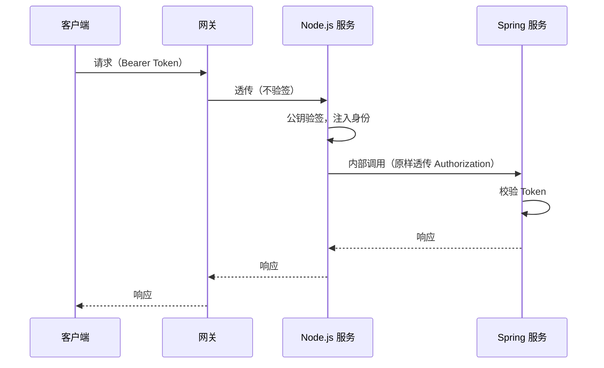

# 网关接入

Spring Cloud Gateway 作为统一入口，通过**静态路由**将不同流量分发到 Spring 服务或 Node.js 服务。客户端只感知一个域名与一套路径，不感知后端技术栈。

## 路由划分

| 路径 | 目标服务 | 协议 | 说明 |
|------|---------|------|------|
| `/api/users/**` | `user-service` (Spring) | HTTP | 用户 CRUD |
| `/api/orders/**` | `order-service` (Spring) | HTTP | 订单 CRUD |
| `/api/devices/**` | `device-service` (Spring) | HTTP | 设备 CRUD |
| `/api/health/**` | `realtime-service` (Node.js) | HTTP | 健康检查（也可直连） |
| `/graphql` | `realtime-service` (Node.js) | HTTP | GraphQL 查询 |
| `/socket.io/**` | `realtime-service` (Node.js) | WebSocket | Socket.IO 长连接 |
| `/sse/**` | `realtime-service` (Node.js) | HTTP 长连接 | SSE 单向推送 |

## 配置示例

```yaml
# application.yml (Spring Cloud Gateway)
spring:
  cloud:
    gateway:
      routes:
        # ===== Node.js 实时服务 =====
        - id: realtime-graphql
          uri: http://realtime-service:3000
          predicates:
            - Path=/graphql
          filters:
            - name: Retry
              args:
                retries: 2
                statuses: BAD_GATEWAY,SERVICE_UNAVAILABLE
            - name: Timeout
              args:
                response-timeout: 10s

        - id: realtime-websocket
          uri: ws://realtime-service:3000
          predicates:
            - Path=/socket.io/**
          filters:
            - name: StripPrefix=0

        - id: realtime-sse
          uri: http://realtime-service:3000
          predicates:
            - Path=/sse/**
          metadata:
            response-timeout: -1
            connect-timeout: 5000

        - id: realtime-health
          uri: http://realtime-service:3000
          predicates:
            - Path=/api/health/**
          filters:
            - name: Timeout
              args:
                response-timeout: 3s

        # ===== Spring 业务服务 =====
        - id: user-service
          uri: lb://user-service
          predicates:
            - Path=/api/users/**
          filters:
            - name: Retry
              args:
                retries: 2
                statuses: BAD_GATEWAY,SERVICE_UNAVAILABLE

        - id: order-service
          uri: lb://order-service
          predicates:
            - Path=/api/orders/**
```

服务侧存在多套对外前缀时（如 `api/v1` 与 `api/v2` 并存），`setGlobalPrefix` 支持数组，无需为每套前缀单独注册控制器：

```ts
// main.ts
app.setGlobalPrefix(['api/v1', 'api/v2']);
```

## WebSocket 路由要点

WebSocket 与 HTTP 路由的核心差异：

| 配置项 | HTTP / GraphQL | WebSocket |
|--------|---------------|-----------|
| `uri` scheme | `http://` | `ws://` |
| Retry | 允许 1-2 次 | **禁止**（长连接不可重试） |
| Response Timeout | 3-10s | **不设置**（连接长期持有） |
| Read Timeout | 默认 | 需调大（默认 30s 会断连） |
| Idle Timeout | 默认 | 需调大（默认 30s 会断连） |
| Sticky Session | 不需要 | **必须**（多实例时握手多请求须落到同一实例） |

```yaml
spring:
  cloud:
    gateway:
      httpclient:
        websocket:
          max-frame-payload-length: 65536
      routes:
        - id: realtime-websocket
          uri: ws://realtime-service:3000
          predicates:
            - Path=/socket.io/**
          metadata:
            response-timeout: -1
            connect-timeout: 5000
```

:::warning
Spring Cloud Gateway 默认的 `response-timeout` 与 `idle-timeout` 对 WebSocket 不友好，必须显式禁用或调大，否则长连接会被强制断开。
:::

### 多实例 Sticky Session

Node.js 服务扩容到多实例后，Socket.IO 握手的多次请求（polling → upgrade）必须落到同一实例，否则握手失败。在负载均衡层配置会话亲和（按客户端 IP 或 Cookie 保持），常见平台的对应配置：

| 平台 | 配置 |
|------|------|
| K8s Service | `sessionAffinity: ClientIP` |
| Nginx | `ip_hash` 或 sticky cookie |
| 云负载均衡 | 开启会话保持（目标组 / 后端服务属性） |

### namespace 隔离与握手鉴权

Socket.IO namespace 按业务域隔离（如设备控制 `device`、通知推送 `notification`），新业务域挂新 namespace，互不干扰。HTTP 握手仍走默认 path `/socket.io/`，namespace 经连接参数传递——网关只需一条 `/socket.io/**` 路由，多业务域不增加网关配置：

```ts
// ws/device.gateway.ts
@WebSocketGateway({ namespace: 'device' })
export class DeviceGateway implements OnGatewayConnection {
  constructor(private readonly jwtService: JwtService) {}

  /** 握手阶段鉴权：客户端 io(url, { auth: { token } }) 携带令牌 */
  async handleConnection(client: Socket): Promise<void> {
    const token = client.handshake.auth?.token;
    try {
      const user = await this.jwtService.verifyAsync<AuthPayload>(
        typeof token === 'string' ? token : '',
      );
      Object.assign(client.data, { user });
    } catch {
      client.disconnect(true);
    }
  }
}
```

## SSE 路由要点

SSE 是长连接 HTTP 响应（`text/event-stream`），网关配置介于普通 HTTP 与 WebSocket 之间：

| 配置项 | 普通 HTTP / GraphQL | SSE |
|--------|--------------------|-----|
| `uri` scheme | `http://` | `http://` |
| Retry | 允许 1-2 次 | **禁止**（断连由客户端自动重连恢复） |
| Response Timeout | 3-10s | **禁用**（连接长期持有） |
| 响应缓冲 | 默认 | **禁用**（缓冲会导致事件积压在网关） |
| 空闲超时 | 默认 | **大于心跳间隔**（服务端周期下发心跳帧保活，见 [SSE · 心跳保活](../../features/sse/README.md#心跳保活)） |
| Sticky Session | 不需要 | 不需要（单请求长连接，无多次握手） |

```yaml
- id: realtime-sse
  uri: http://realtime-service:3000
  predicates:
    - Path=/sse/**
  metadata:
    response-timeout: -1
    connect-timeout: 5000
```

:::warning
若网关联调时出现“事件批量延迟到达”而非实时下发，优先检查链路上的缓冲：Spring Cloud Gateway 默认不缓冲响应体，但前置的 Nginx / Ingress 需要显式 `X-Accel-Buffering: no`（或 `proxy_buffering off`）。
:::

## 认证透传

采用 **Token 端到端透传**：统一认证服务签发 JWT（ES256），网关只做路由不做验签；Node.js 服务以公钥自行验签（实现见 [认证授权](../../features/authentication/README.md)），调用下游时把原始 `Authorization` 头透传，Spring 侧二次校验。每个下游独立验证凭据，不依赖上游信任链：



```ts
const order = await this.springClient.get(
  'order',
  `/internal/orders/${orderId}`,
  { authorization: rawAuthorizationHeader },
);
```

- 令牌撤销、权限变更在下游即时生效（每个服务独立校验）
- 审计链路完整：任一跳都能还原真实调用者
- 验签公钥经环境变量注入（PEM），未配置时认证禁用——仅限本地开发

## 健康检查与摘除

Node.js 服务暴露 `/api/health`（存活）与 `/api/health/ready`（就绪），供网关与负载均衡探针使用，实现见 [可观测性 · 健康检查](../observability/README.md#健康检查)：

- **存活探针**：仅确认进程运行，不检查依赖
- **就绪探针**：确认 Redis、Kafka 等依赖可用，不可用则从负载均衡摘除
